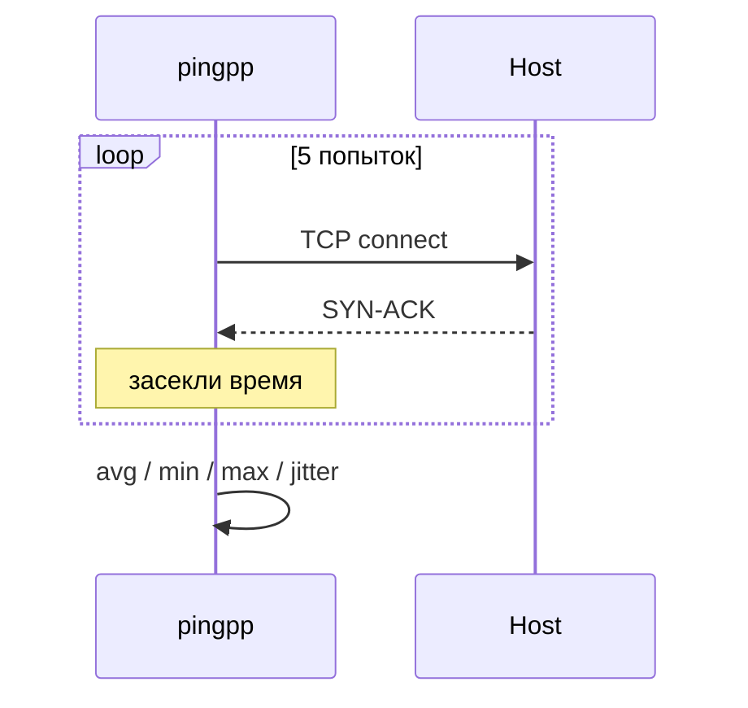

# pingpp

[](https://github.com/devsavsis/pingpp/actions/workflows/ci.yml)
[](https://github.com/devsavsis/pingpp/blob/master/LICENSE)

меряет задержку и джиттер до хостов через обычный TCP-connect, без ICMP и прав администратора. удобно быстро глянуть какая VPN-нода бодрее.



## сборка

```
cmake -B build
cmake --build build --config Release
```

## юзать

```
build\Release\pingpp.exe 1.1.1.1:443 vpn.example.com:51820
```
